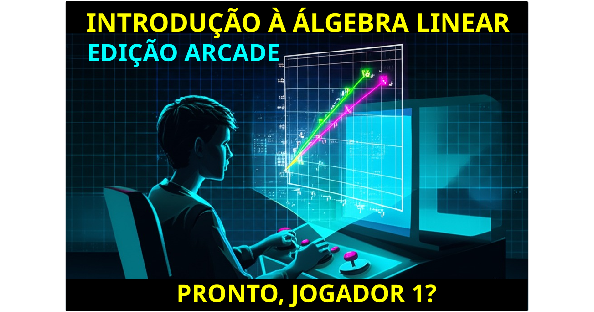

Bem-vindo, Jogador! Você está prestes a iniciar uma jornada pelo universo da Álgebra Linear. Este é um mundo vasto, cheio de desafios, segredos e ferramentas poderosas. Sua missão, caso decida aceitar, é dominar suas regras, coletar seus artefatos e provar sua maestria. Que comecem os jogos!

<!--
### 🎮 Missão de Feedback: Ajude a Calibrar o Jogo! 🎮

Olá, Jogador!

Sua jornada até agora é muito importante para mim. Para garantir que o "jogo" esteja bem balanceado, divertido e justo para todos, criei uma pesquisa rápida.

Suas respostas são **100% anônimas** e levarão apenas 5 minutos. Seu feedback é o 'power-up' que preciso para melhorar o curso *para vocês*!

[**>> INICIAR MISSÃO DE FEEDBACK (RESPONDER PESQUISA) <<**](https://docs.google.com/forms/d/e/1FAIpQLSd7dUipQLabz1EziTpv5VrTHZu0hu50yHQTzOGxs_82DjpqvA/viewform)

Muito obrigado pela sua colaboração!
-->

## Mapa da Missão

- [O Manual do Jogador (Livro Adotado)](#-o-manual-do-jogador-livro-adotado)
- [Fases da Missão (Ementa)](#-fases-da-missão-ementa-do-curso)
  - [Fase 1: As Regras do Jogo - Sistemas e Matrizes](#fase-1-as-regras-do-jogo---sistemas-e-matrizes)
  - [Fase 2: A Primeira Chave - Determinantes](#fase-2-a-primeira-chave---determinantes)
  - [Fase 3: Explorando o Espaço - Vetores Euclidianos](#fase-3-explorando-o-espaço---vetores-euclidianos)
  - [Fase 4: Portais e Avatares - Transformações Lineares](#fase-4-portais-e-avatares---transformações-lineares)
  - [Fase 5: As Leis do Universo - Espaços Vetoriais Abstratos](#fase-5-as-leis-do-universo---espaços-vetoriais-abstratos)
  - [Fase Final: O Código-Fonte - Autovalores e Autovetores](#fase-final-o-código-fonte---autovalores-e-autovetores)
- [Calendário da Temporada (2026/2)](#-calendário-da-temporada-20262)
- [Itens Bônus](#-itens-bônus)

---

### 📖 O Manual do Jogador (Livro Adotado)

  
Clique para acessar o guia oficial da jornada

  O guia essencial para todo Jogador neste universo é:

  **"Álgebra Linear com Aplicações"** de Howard Anton

  - 📢 **Atenção, Jogadores!** 📢
  - 📖 **LEITURA OBRIGATÓRIA** do manual! 🔍
  - 🎓 Em nossas sessões (aulas), vamos focar nas *quests* mais complexas.
  - 🏠 Outros portais de conhecimento importantes devem ser explorados individualmente no manual.

---

## 🗺️ Fases da Missão (Ementa do Curso)

### FASE 1: As Regras do Jogo - Sistemas e Matrizes [🎧](https://oangelo.github.io/Introducao-a-Algebra-Linear/audio/matrizes_sistemas_bill.mp3)

- **Quest 1.1:** [A primeira charada: Sistemas de equações lineares](https://oangelo.github.io/Introducao-a-Algebra-Linear/exercicios/capitulo-1/sistemas-lineares.html)
- **Quest 1.2:** [O "Glitch" da Eliminação Gaussiana](https://oangelo.github.io/Introducao-a-Algebra-Linear/exercicios/capitulo-1/eliminacao-gaussiana.html) [👨‍🏫](https://oangelo.github.io/Introducao-a-Algebra-Linear/slide-decks/eliminacao_gaussiana.html)
- **Quest 1.3:** [O inventário: Matrizes e suas propriedades](https://oangelo.github.io/Introducao-a-Algebra-Linear/exercicios/capitulo-1/propriedades-matriciais.html) [👨‍🏫](https://oangelo.github.io/Introducao-a-Algebra-Linear/slide-decks/propriedades.html)
- **Quest 1.4:** [O Artefato do "Undo": Matrizes Inversas](https://oangelo.github.io/Introducao-a-Algebra-Linear/exercicios/capitulo-1/matrizes-inversas.html) [👨‍🏫](https://oangelo.github.io/Introducao-a-Algebra-Linear/slide-decks/inversas.html)
- **Mini-Chefe:** [Quiz da Fase 1](quiz/matrizes_e_sitemas.md)

🔍 Glossário da Fase 1

* **Sistema Linear:** Um conjunto de *puzzles* lineares com as mesmas incógnitas.
* **Matriz:** O "grid" do jogo, onde os dados (elementos) são organizados.
* **Vetor:** Uma linha ou coluna do grid. Um personagem unidimensional.
* **Matriz Aumentada:** O mapa do *puzzle*, mostrando os coeficientes e os resultados.
* **Operações Elementares:** Os movimentos básicos permitidos para resolver o mapa sem quebrar o jogo.
* **Forma Escalonada / Reduzida:** O mapa do *puzzle* simplificado, revelando o caminho para a solução.
* **Matriz Inversa:** O "Ctrl+Z" do jogo. Desfaz a transformação de uma matriz.

### FASE 2: A Primeira Chave - Determinantes [👨‍🏫](https://oangelo.github.io/Introducao-a-Algebra-Linear/slide-decks/determinante.html) [📝](quiz/determinantes.md) [🎧](https://oangelo.github.io/Introducao-a-Algebra-Linear/audio/determinants_bill.mp3)
A primeira grande chave que abre novas áreas do jogo.

- **Quest 2.1:** [Decodificação recursiva: Expansão em Cofatores](https://oangelo.github.io/Introducao-a-Algebra-Linear/exercicios/capitulo-2/determinantes-cofatores.html)
- **Quest 2.2:** [Simplificando o código: Redução por Linhas](https://oangelo.github.io/Introducao-a-Algebra-Linear/exercicios/capitulo-2/determinantes-reducao.html)
- **Quest 2.3:** [As regras secretas: Propriedades dos Determinantes](https://oangelo.github.io/Introducao-a-Algebra-Linear/exercicios/capitulo-2/propriedades-determinantes.html)
- **Quest 2.4:** [A Chave Mestra de Cramer](https://oangelo.github.io/Introducao-a-Algebra-Linear/exercicios/capitulo-2/regra-cramer.html)

🔍 Glossário da Fase 2

* **Determinante:** A "assinatura digital" de uma matriz quadrada. Um número que revela seus segredos.
* **Menor / Cofator:** Peças do *puzzle* para calcular o determinante.
* **Adjunta:** Uma matriz especial construída a partir dos cofatores.
* **Regra de Cramer:** Uma "fórmula mágica" que usa a Primeira Chave para resolver sistemas.

### FASE 3: Explorando o Espaço - Vetores Euclidianos [👨‍🏫](https://oangelo.github.io/Introducao-a-Algebra-Linear/slide-decks/espacos-vetoriais-euclidianos.html)
Navegando pelo mundo 3D (e além) do jogo.

- **Quest 3.1:** [Vetores: seus personagens no espaço](https://oangelo.github.io/Introducao-a-Algebra-Linear/exercicios/capitulo-3/vetores.html)
- **Quest 3.2:** [Norma e Distância: medindo seu poder e o caminho](https://oangelo.github.io/Introducao-a-Algebra-Linear/exercicios/capitulo-3/norma-e-distancia.html)
- **Quest 3.3:** [Ortogonalidade: ângulos retos e atalhos](https://oangelo.github.io/Introducao-a-Algebra-Linear/exercicios/capitulo-3/ortogonalidade.html)
- **Quest 3.4:** [Retas e planos](https://oangelo.github.io/Introducao-a-Algebra-Linear/exercicios/capitulo-3/retas-e-planos.html)
- **Quest 3.5:** [A Geometria dos Sistemas Lineares](https://oangelo.github.io/Introducao-a-Algebra-Linear/exercicios/capitulo-3/geometria-sistemas-lineares.html)
- **Quest 3.6:** [Produto Vetorial: uma nova dimensão de interação](https://oangelo.github.io/Introducao-a-Algebra-Linear/exercicios/capitulo-3/produto-vetorial.html)
- **Mini-Chefe:** [Quiz da Fase 3](quiz/ga.md)

🔍 Glossário da Fase 3

(Seu glossário atual já está excelente e se encaixa perfeitamente aqui)

### FASE 4: Portais e Avatares - Transformações Lineares [👨‍🏫](https://oangelo.github.io/Introducao-a-Algebra-Linear/slide-decks/transformacoes.html)
Aprendendo a se teleportar e a transformar seu personagem.

- **Quest 4.1:** [O Primeiro Portal (Aplicando Matrizes de Transformação)](https://oangelo.github.io/Introducao-a-Algebra-Linear/exercicios/capitulo-4/aplicando.html)
- **Quest 4.2:** [O Arsenal do Mestre do Jogo (Construindo Matrizes de Transformação)](https://oangelo.github.io/Introducao-a-Algebra-Linear/exercicios/capitulo-4/transformacoes-lineares.html)
- **Quest 4.3:** [Combos e Reversões (Composição e Invertibilidade)](https://oangelo.github.io/Introducao-a-Algebra-Linear/exercicios/capitulo-4/combos-e-reversoes.html)

### FASE 5: As Leis do Universo - Espaços Vetoriais Abstratos [👨‍🏫 - 1](https://oangelo.github.io/Introducao-a-Algebra-Linear/slide-decks/espaco-vetorial-pt1.html) [👨‍🏫 - 2](https://oangelo.github.io/Introducao-a-Algebra-Linear/slide-decks/espaco-vetorial-pt2.html)
Explorando as regras que governam não apenas este jogo, mas todos os universos possíveis.

- **Quest 5.1:** [Espaços vetoriais reais e seus 10 axiomas](https://oangelo.github.io/Introducao-a-Algebra-Linear/exercicios/capitulo-5/espacos-vetoriais-reais.html)
- **Quest 5.2:** [Subespaços (Zonas Seguras)](https://oangelo.github.io/Introducao-a-Algebra-Linear/exercicios/capitulo-5/subespacos.html)
- **Quest 5.3:** [Independência Linear (Personagens únicos)](https://oangelo.github.io/Introducao-a-Algebra-Linear/exercicios/capitulo-5/independencia-linear.html)
- **Quest 5.4:** [Coordenadas e Bases (O sistema de GPS do universo)](https://oangelo.github.io/Introducao-a-Algebra-Linear/exercicios/capitulo-5/coordenadas-e-bases.html)
- **Quest 5.5:** [Dimensão, Posto e Nulidade](https://oangelo.github.io/Introducao-a-Algebra-Linear/exercicios/capitulo-5/dimensao-posto-nulidade.html)
- **Mini-Chefe:** [Quiz da Fase 5](quiz/espaco_linear.md)

🔍 Glossário da Fase 5

(Seu glossário atual já está excelente)

### FASE FINAL: O Código-Fonte - Autovalores e Autovetores [👨‍🏫](https://oangelo.github.io/Introducao-a-Algebra-Linear/slide-decks/eigenbase.html)
A busca pelo *Easter Egg* final: os segredos mais profundos da estrutura do jogo.

- **Quest 6.1:** [Autovalores e Autovetores: as "direções preferenciais"](https://oangelo.github.io/Introducao-a-Algebra-Linear/exercicios/capitulo-6/autovalores-e-autovetores.html)
- **Quest 6.2:** [Diagonalização: simplificando a própria realidade](https://oangelo.github.io/Introducao-a-Algebra-Linear/exercicios/capitulo-6/diagonalizacao.html)
- **Chefe Final:** [Quiz da Fase Final](quiz/auto_valores_vetores.md)

🔍 Glossário da Fase Final

(Seu glossário atual já está excelente)

---

## 📅 Calendário da Temporada — 2026/2

A temporada tem **17 aulas**, sempre às quartas, 09:40–12:20, de 18/nov/2026 a 14/abr/2027. São 5 fases, e cada uma fecha com uma prova escrita no último dia da fase. Datas de aula, provas e recessos estão no [planejamento da temporada](planejamento/planejamento-IAL-2026-2.md).

---

### 🎲 Itens Bônus
- [Roleta de Desafios](https://oangelo.github.io/Introducao-a-Algebra-Linear/roleta.html): Gire para uma *side quest* aleatória e ganhe XP extra!

---

---

## Informações Institucionais

Este material didático foi desenvolvido pelo **Prof. Angelo Mondaini Calvão** e é utilizado nas disciplinas de Introdução à Álgebra Linear dos cursos de **Engenharia Mecânica** e **Engenharia de Computação** do Instituto Politécnico do Rio de Janeiro (IPRJ), campus regional da **Universidade do Estado do Rio de Janeiro (UERJ)** em Nova Friburgo.

🍀 Boa sorte na sua jornada, Jogador! Que o *Easter Egg* final seja seu. 🎮
